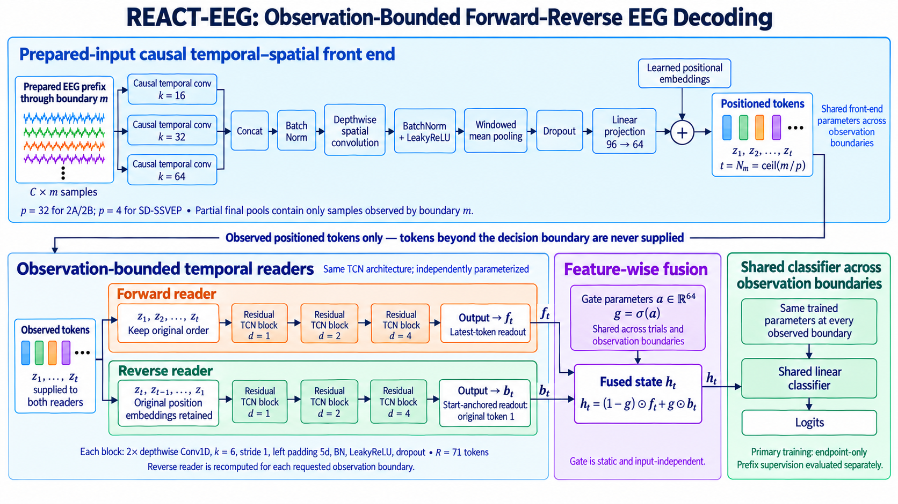

# REACT-EEG

## Reverse-Encoded Anytime Causal Temporal Modeling for EEG Decoding

Official research code accompanying:

**REACT-EEG: Reverse-Encoded Anytime Causal Temporal Modeling for EEG Decoding**

Accepted at the **7th International Workshop on Machine Learning for EEG Signal Processing (MLESP 2026)**, held in conjunction with **IEEE BIBM 2026**.

REACT-EEG is an anytime EEG decoder that uses only the EEG available when a prediction is requested. The model combines a forward temporal reader, summarized at the newest observed token, with an independently parameterized reverse reader that processes the observed tokens from newest to oldest. Their representations are combined using a learned feature-wise gate before classification.

A single trained checkpoint can be evaluated at multiple observation lengths without training a separate model for every decision time.

## Model Architecture

<p align="center">
  
</p>

<p align="center">
  <em>REACT-EEG architecture at observation boundary \(m\). Only EEG observed up to the requested boundary is supplied to the model. A causal temporal-spatial front end constructs tokens, which are processed by forward and reverse temporal readers and combined through feature-wise gated fusion.</em>
</p>

## Repository Structure

```text
REACT-EEG/
├── README.md
├── figure.png
│
├── main_source/
│   └── fresh/
│       ├── models.py
│       ├── controls.py
│       ├── data.py
│       ├── bite.py
│       ├── setup.py
│       ├── run.py
│       ├── smoke.py
│       ├── report.py
│       └── statistics_base.py
│
└── anchor_source/
    ├── fresh/
    │   └── ...
    ├── train_reverse_only_final.py
    ├── train_paired_random_trunc_final.py
    ├── reviewer_eval_controls.py
    ├── bite_zerofill_final.py
    ├── final_endpoint_stats.py
    ├── summarize_reverse_only.py
    ├── summarize_paired_random_trunc_final.py
    ├── fresh_primary_nauc.py
    ├── check_fresh_causality.py
    └── make_fresh_anytime_figure.py
```

`main_source/fresh/` contains the primary REACT-EEG implementation and within-subject training pipeline.

`anchor_source/` contains the mechanism-control and reviewer-analysis workflows used for the final manuscript, including reverse-only training, paired random-duration training, mean-imputation evaluation, causality summaries, and accuracy-time analysis.

The two source trees contain separate `fresh` packages. Run commands from the working directories shown below rather than adding both packages to `PYTHONPATH` simultaneously.

This public release does **not** include raw EEG data, trained checkpoints, cluster logs, temporary outputs, manuscript drafts, or the separate LOSO/additional endpoint-baseline training pipelines.

## Installation

Python **3.11 or later** is recommended.

Create an isolated environment:

```bash
git clone https://github.com/AI-for-Health-Data/REACT-EEG.git
cd REACT-EEG

export REACT_ROOT="$PWD"

python3 -m venv .venv
source .venv/bin/activate
```

Install a PyTorch build appropriate for your hardware using the official PyTorch installation instructions:

https://pytorch.org/get-started/locally/

Then install the remaining dependencies:

```bash
python -m pip install \
    numpy==2.3.5 \
    scipy==1.17.0 \
    scikit-learn==1.8.0 \
    pandas==2.2.3 \
    matplotlib==3.10.8
```

The listed package versions were used for local source validation and are not intended as a recovered lockfile for the original HPC training environment.

Git is also required because the study setup retrieves the pinned BiTE implementation.

## Quick Model Check

The following example checks REACT-EEG output dimensions and trainable parameter counts using random data. It does not load trained weights or evaluate classification accuracy.

```bash
PYTHONPATH="$REACT_ROOT/main_source" python - <<'PY'
import torch
from fresh.data import SPECS, grid
from fresh.models import make_model

torch.set_num_threads(1)

expected = {
    "2a": 18916,
    "2b": 16962,
    "ssvep": 20140,
}

for dataset, cfg in SPECS.items():
    model = make_model(
        channels=cfg["channels"],
        classes=cfg["classes"],
        max_samples=cfg["samples"],
        pool=cfg["pool"],
        kind="reader",
        seed=2025,
    )

    model.project_constraints()
    model.eval()

    count = sum(p.numel() for p in model.parameters())
    assert count == expected[dataset]

    x = torch.randn(2, cfg["channels"], cfg["samples"])

    with torch.inference_mode():
        for m in (grid(dataset)[0], cfg["samples"]):
            y = model(x[:, :, :m])
            assert y.shape == (2, cfg["classes"])

    print(f"{dataset}: {count:,} parameters; checks passed")
PY
```

Expected REACT parameter counts are:

| Dataset | Parameters |
|---|---:|
| BCICIV-2A | 18,916 |
| BCICIV-2B | 16,962 |
| SD-SSVEP | 20,140 |

REACT adds 3,136 trainable parameters relative to either single-reader control.

## Datasets

The datasets and prepared NPZ files are **not distributed in this repository**.

The experiments use:

| Dataset | Code key | Subjects | Channels | Classes | Sampling rate | Model input | Pool width |
|---|---|---:|---:|---:|---:|---:|---:|
| BCICIV-2A | `2a` | 9 | 22 | 4 | 250 Hz | 1,000 samples / 4 s | 32 |
| BCICIV-2B | `2b` | 9 | 3 | 2 | 250 Hz | 1,000 samples / 4 s | 32 |
| SD-SSVEP | `ssvep` | 10 | 8 | 12 | 256 Hz | 256 samples / 1 s | 4 |

Prepared `.npz` files must contain:

```text
data   : numeric array [trials, channels, samples]
label  : one-dimensional integer array [trials]
```

Labels are expected to be zero-based integer class indices.

### Expected Filenames

```text
2a_pre/
    A01T.npz
    A01E.npz
    ...
    A09T.npz
    A09E.npz

2b_pre/
    B0101T.npz
    B0102T.npz
    B0103T.npz
    B0104E.npz
    B0105E.npz
    ...
    # corresponding files for subjects 1–9

sdssvep_pre/
    S01_train.npz
    S01_test.npz
    ...
    S10_train.npz
    S10_test.npz
```

BCICIV-2A uses the official training session for model fitting and the official evaluation session for testing.

BCICIV-2B uses sessions 1–3 for training and sessions 4–5 for testing.

SD-SSVEP uses the supplied per-subject training and testing files without repartitioning.

The model loader fits `StandardScaler` using training data only, separately at each channel-sample coordinate, and applies the frozen transformation to held-out inputs.

Motor-imagery arrays may contain 1,000 or 1,001 samples; only the first 1,000 are retained. SD-SSVEP inputs contain 256 samples.

**Raw-to-NPZ conversion and construction of the original SD-SSVEP split are not included in this source release.**

See:

```text
main_source/fresh/data.py
```

for the input validation and loading behavior.

## Configure a Study

Set the prepared-data locations and choose a new output directory outside the repository:

```bash
export REACT_DATA_2A="/absolute/path/to/2a_pre"
export REACT_DATA_2B="/absolute/path/to/2b_pre"
export REACT_DATA_SSVEP="/absolute/path/to/sdssvep_pre"

export REACT_STUDY="/absolute/path/to/new_react_study"
```

Create the study:

```bash
python - <<'PY'
import os
import shutil
import sys
from pathlib import Path

repo = Path(os.environ["REACT_ROOT"]).expanduser().resolve()
study = Path(os.environ["REACT_STUDY"]).expanduser().resolve()

roots = {
    "2a": str(Path(os.environ["REACT_DATA_2A"]).expanduser().resolve()),
    "2b": str(Path(os.environ["REACT_DATA_2B"]).expanduser().resolve()),
    "ssvep": str(Path(os.environ["REACT_DATA_SSVEP"]).expanduser().resolve()),
}

if not (repo / "main_source/fresh/models.py").is_file():
    raise SystemExit("REACT_ROOT must point to the repository root.")

if study.exists() or study == repo or repo in study.parents:
    raise SystemExit(
        "Choose a new study directory outside the repository."
    )

if not all(Path(root).is_dir() for root in roots.values()):
    raise SystemExit("A prepared-data directory does not exist.")

study.mkdir(parents=True)

shutil.copytree(
    repo / "main_source",
    study / "code",
    ignore=shutil.ignore_patterns("__pycache__", ".pytest_cache"),
)

sys.path.insert(0, str(study / "code"))

from fresh import setup

setup.DEFAULT_ROOTS.update(roots)
setup.freeze(study)
PY
```

The setup records the study configuration, freezes the primary source tree, checks the expected data files, and retrieves the pinned BiTE implementation at:

```text
924eb32241ba1a7c80dbc4ba097f8c979da17578
```

The retrieved baseline is placed under:

```text
$REACT_STUDY/third_party/BiteEEG/
```

Review its dependency file and install any additional requirements before training.

Do not modify the frozen study source or configuration after training begins.

## GPU Preflight

On a CUDA-capable compute node:

```bash
(
    cd "$REACT_STUDY/code"
    python -m fresh.smoke --study "$REACT_STUDY"
)
```

The preflight checks the software and training-role data. It is not a held-out benchmark evaluation.

## Primary Training

Run a single task:

```bash
(
    cd "$REACT_STUDY/code"
    python -m fresh.run \
        --study "$REACT_STUDY" \
        --index 0 \
        --device cuda
)
```

Task `0` corresponds to:

```text
BCICIV-2A
subject 1
seed 2025
```

Each task trains the five primary models:

| Paper name | Code identifier |
|---|---|
| REACT-EEG / REACT | `reader` |
| No reverse | `compact` |
| Two forward | `ff` |
| Forward mean | `compact_mean` |
| BiTE | `bite` |

The complete primary experiment contains 84 subject-seed tasks:

| Dataset | Task indices |
|---|---:|
| BCICIV-2A | 0–26 |
| BCICIV-2B | 27–53 |
| SD-SSVEP | 54–83 |

Tasks are ordered by dataset, subject, and seed:

```text
2025
2026
2027
```

A complete sequential run can be launched with:

```bash
(
    set -e
    cd "$REACT_STUDY/code"

    for INDEX in $(seq 0 83); do
        python -m fresh.run \
            --study "$REACT_STUDY" \
            --index "$INDEX" \
            --device cuda
    done
)
```

For HPC use, a reviewed scheduler array is recommended instead.

## Training Configuration

The primary experiments use:

```text
Epochs                  600
Batch size              64
Optimizer               Adam
Learning rate           0.002
Weight decay            0.002
Betas                    (0.9, 0.999)
Epsilon                  1e-8
Learning-rate schedule   cosine decay to zero
Label smoothing          0.1
Gradient clipping        5
Evaluation checkpoint    final epoch
Seeds                    2025, 2026, 2027
```

Shared components use matched initialization across corresponding models.

### BiTE

BiTE uses its released implementation and dataset-specific settings within the shared 600-epoch training framework, with gradient-norm clipping at 5, consistent with the camera-ready manuscript.

## Observation-Time Evaluation

BCICIV-2A and BCICIV-2B are evaluated from **1 to 4 s** over **28 observation boundaries**.

SD-SSVEP is evaluated from **0.25 to 1 s** of the retained segment over **49 observation boundaries**.

The same trained checkpoint is reused at all observation boundaries.

Inputs are physically truncated at the requested boundary except in the explicit mean-imputation controls.

Incomplete final pooling windows use only the samples observed at the requested boundary.

## Reverse-Only Control

Reverse only is trained independently rather than being constructed by disabling the forward route of a trained REACT model.

Set an output root for the control experiments:

```bash
export REACT_CONTROLS="/absolute/path/to/new_control_outputs"
```

Run one subject-seed task with:

```bash
python "$REACT_ROOT/anchor_source/train_reverse_only_final.py" \
    --study "$REACT_STUDY" \
    --out "$REACT_CONTROLS/reverse_only" \
    --task-index 0 \
    --device cuda
```

For the complete cohort, run task indices `0–83`.

## Paired Random-Duration Training

Run:

```bash
python "$REACT_ROOT/anchor_source/train_paired_random_trunc_final.py" \
    --study "$REACT_STUDY" \
    --out "$REACT_CONTROLS/random_duration" \
    --task-index 0 \
    --device cuda
```

The REACT and No-reverse arms receive identical minibatch orders and observation-duration schedules.

One observation boundary is sampled uniformly from the evaluation grid for each minibatch, and one label-smoothed cross-entropy loss is evaluated at that duration.

No additional endpoint-weighted loss is used.

For the complete cohort, run task indices `0–83`.

## Fixed-Anchor and Endpoint-Aligned Controls

These controls are implemented in the retained `anchor_source/fresh/` package.

Run:

```bash
(
    cd "$REACT_ROOT/anchor_source"

    PYTHONPATH=. python -m fresh.anchor_diag \
        --orig-study "$REACT_STUDY" \
        --out "$REACT_CONTROLS/anchor" \
        --index 0 \
        --device cuda
)
```

For the complete cohort, run indices `0–83`.

## Mean-Imputation Controls

The mean-imputation evaluations retain the complete input geometry and replace unavailable standardized samples with zero, corresponding to the training-set mean.

For No reverse and REACT-related mechanism controls:

```bash
python "$REACT_ROOT/anchor_source/reviewer_eval_controls.py" \
    --study "$REACT_STUDY" \
    --out "$REACT_CONTROLS/mean_imputation" \
    --dataset all \
    --device cuda
```

For BiTE:

```bash
python "$REACT_ROOT/anchor_source/bite_zerofill_final.py" \
    --study "$REACT_STUDY" \
    --out "$REACT_CONTROLS/bite_mean_imputation" \
    --device cuda
```

Mean imputation changes the supplied sequence and subsequent computation and should not be interpreted as isolating temporal reversal alone.

## Accuracy-Time Analysis

Seed accuracies are first averaged within each subject.

Normalized area under the accuracy-time curve (nAUC) is calculated using trapezoidal integration divided by the evaluated observation interval.

nAUC is **not ROC AUC**.

Primary nAUC summaries can be generated with:

```bash
python "$REACT_ROOT/anchor_source/fresh_primary_nauc.py" \
    "$REACT_STUDY"
```

## Causality Verification

The paper defines causality at the prepared model input.

At each observation boundary, predictions may depend only on the EEG samples available up to that boundary.

Existing causality records can be summarized using:

```bash
python "$REACT_ROOT/anchor_source/check_fresh_causality.py" \
    "$REACT_STUDY"
```

The verification compares boundary evaluation with direct cropped-input evaluation and includes a future-perturbation test.

A positive control injects dependence on the first unobserved sample into one class logit and verifies that the future-perturbation test detects the leak.

## Accuracy-Time Figure

Generate the primary accuracy-time figure with:

```bash
mkdir -p "$REACT_CONTROLS/figures"

MPLBACKEND=Agg \
python "$REACT_ROOT/anchor_source/make_fresh_anytime_figure.py" \
    "$REACT_STUDY" \
    "$REACT_CONTROLS/figures/fig2.pdf"
```

The primary figure includes:

```text
REACT
No reverse
Two forward
Forward mean
```

## Statistical Summaries

The following retained scripts generate the final statistical summaries:

```text
anchor_source/final_endpoint_stats.py
anchor_source/summarize_reverse_only.py
anchor_source/summarize_paired_random_trunc_final.py
```

These scripts retain experiment-path constants from the final analysis environment.

Configure the relevant paths in a working copy before running them.

## Selected Results

The manuscript reports the following REACT results:

| Dataset | Earliest accuracy (%) | nAUC | Endpoint accuracy (%) | Parameters |
|---|---:|---:|---:|---:|
| BCICIV-2A | 69.32 | 80.12 | 85.06 | 18,916 |
| BCICIV-2B | 74.31 | 83.59 | 86.20 | 16,962 |
| SD-SSVEP | 34.89 | 64.15 | 96.50 | 20,140 |

Earliest evaluated boundaries are:

```text
BCICIV-2A   1.00 s
BCICIV-2B   1.00 s
SD-SSVEP    0.25 s
```

Under matched random-duration training, the reported REACT-minus-No-reverse nAUC differences are:

| BCICIV-2A | BCICIV-2B | SD-SSVEP |
|---:|---:|---:|
| +10.42 [6.44, 15.21] | +0.22 [−1.17, 1.61] | +24.96 [19.17, 30.93] |

Values are percentage-point differences with 95% paired subject-bootstrap intervals.

The paper does not claim that REACT is uniformly superior across architectures, datasets, or observation durations. Independently trained reverse-only decoding can outperform the fused model at early observation boundaries.

## Scope of This Release

This repository contains the code needed for the primary within-subject REACT experiments and the main mechanism controls reported in the manuscript.

The following are intentionally not distributed here:

```text
Raw EEG datasets
Prepared dataset files
Trained model checkpoints
HPC logs
Temporary experiment outputs
Internal evidence/audit archives
Old manuscript versions
LOSO training pipeline
Separate additional endpoint-baseline pipelines
```

The LOSO and additional endpoint-baseline results reported in the paper are retained as experimental results, but their separate training workflows are not part of this public source release.

## Citation

If you use this repository, please cite:

> N. Hooman, M. H. Behboudi, H. Y. Adarbah, and M. Gupta,  
> “REACT-EEG: Reverse-Encoded Anytime Causal Temporal Modeling for EEG Decoding,”  
> MLESP 2026, in conjunction with IEEE BIBM 2026.

Nikkie Hooman and Mohammad Hossein Behboudi contributed equally to this work.
